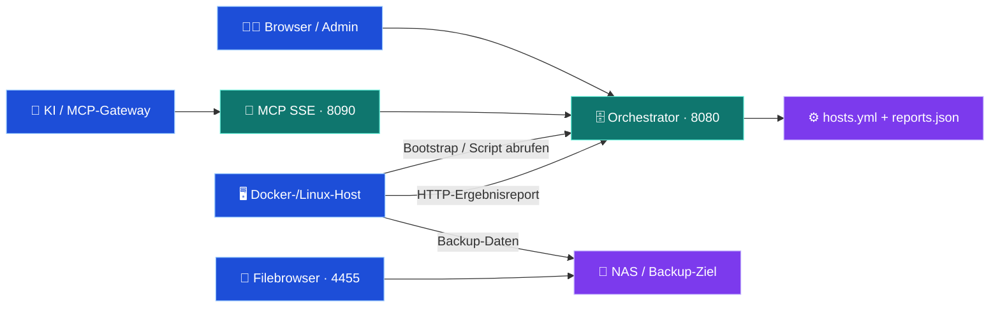

# 🗄️ hAI.BackupServer

[](https://www.buymeacoffee.com/highfish)

[](https://github.com/jbkunama1/hAI.BackupServer/actions/workflows/ghcr.yml)
[](docker-compose.yml)
[](app/main.py)
[](mcp_server/README.md)
[](LICENSE)
[](https://github.com/jbkunama1/hAI.BackupServer/stargazers)
[](https://github.com/jbkunama1/hAI.BackupServer/issues)

> Zentrales Backup-Control-Center für Docker- und Linux-Hosts: Web-Dashboard, automatisch generierte Bash-Scripte, REST-API, MCP-Anbindung und Backup-Reports.

`self-hosted` · `docker` · `backup` · `fastapi` · `bash` · `rsync` · `monitoring` · `mcp` · `portainer` · `ghcr`

---

## 🧭 Navigation

[Features](#-features) · [Architektur](#-architektur) · [Quickstart](#-quickstart-mit-ghcr) · [Portainer](#-portainer-deployment) · [Hosts](#-hosts-anbinden) · [Monitoring](#-monitoring) · [Sicherheit](#-sicherheit--grenzen) · [Roadmap](#-roadmap)

## ✨ Features

| Bereich | Funktion |
|---|---|
| 🖥️ Web-UI | Hosts anlegen, bearbeiten und Backup-Scripte herunterladen |
| 🧩 Script-Generator | Individuelle Bash-Scripte aus Jinja2-Templates |
| 📦 Container-Backup | Docker-Images, konfigurierte Volume-/Bind-Pfade, optionale PostgreSQL-Dumps und Crontab |
| 🚀 Bootstrap | Hostbezogenes Installationsscript mit Cron-Einrichtung |
| 📊 Monitoring | Letzter Report pro Host: OK/Fehler, Empfangszeit, Dauer und Datenmenge |
| 🤖 MCP | Sieben Tools über einen separaten SSE-Service |
| 📂 Filebrowser | Separater Container zum Durchsehen des Backup-Ziels |
| 🐳 GHCR | Workflow für Orchestrator und MCP auf AMD64 und ARM64 |

Baut auf [hAI.FullBackupScript](https://github.com/jbkunama1/hAI.FullBackupScript) auf. Die Sicherung läuft auf dem jeweiligen Host; der Orchestrator verwaltet Konfiguration, Scripte und Reports.

## 🌐 Architektur



Die Compose-Services nutzen das externe Docker-Netzwerk `highfishNetwork`. Der Netzwerkname stellt keinen NAS-Mount auf den Clients her.

## 🚀 Quickstart mit GHCR

Voraussetzungen: Docker mit Compose, erreichbare GHCR-Images und ein auf jedem Backup-Host passend eingerichtetes Backup-Ziel.

```bash
git clone https://github.com/jbkunama1/hAI.BackupServer.git
cd hAI.BackupServer
cp .env.example .env
# .env bearbeiten: BASIC_AUTH_PASSWORD setzen!
cp app/config/hosts.yml.example app/config/hosts.yml

# Nur anlegen, falls noch nicht vorhanden:
docker network inspect highfishNetwork >/dev/null 2>&1 || docker network create highfishNetwork

docker compose --env-file .env pull
docker compose --env-file .env up -d
```

Die Compose-Datei verwendet vorgebaute Images, keinen lokalen Build:

| Service | Image |
|---|---|
| Orchestrator | `ghcr.io/jbkunama1/hai.backupserver-orchestrator:latest` |
| MCP | `ghcr.io/jbkunama1/hai.backupserver-mcp:latest` |
| Filebrowser | `filebrowser/filebrowser:latest` |

Der [GHCR-Workflow](.github/workflows/ghcr.yml) baut bei Push auf `main` oder manuellem Start für `linux/amd64` und `linux/arm64`. Tags: `latest` auf dem Default-Branch und `sha-<Kurz-SHA>`. Vor einem Deployment den erfolgreichen Workflow-Lauf prüfen. Private GHCR-Pakete benötigen Registry-Zugangsdaten; für anonymes Pulling muss die Paketsichtbarkeit public sein.

### 🔗 Zugänge (Beispielhost)

| Dienst | Adresse |
|---|---|
| Web-UI | `http://192.168.178.26:8080` |
| REST-API-Dokumentation | `http://192.168.178.26:8080/docs` |
| MCP SSE | `http://192.168.178.26:8090/sse` |
| Filebrowser | `http://192.168.178.26:4455` |

## 🐳 Portainer-Deployment

1. `highfishNetwork` auf dem Ziel-Docker-Host bereitstellen.
2. In Portainer: Stacks → Add stack → Repository.
3. Repository: `https://github.com/jbkunama1/hAI.BackupServer`.
4. Reference: `refs/heads/main`; Compose path: `docker-compose.yml`.
5. `BASIC_AUTH_PASSWORD` und die benötigten Variablen setzen.
6. NAS-Pfad und Bind-Mounts für die konkrete Portainer-Umgebung prüfen.
7. Stack deployen; bei Updates aktuelle Images explizit neu pullen.

> ⚠️ Öffentliches Git-Repository und öffentliche GHCR-Pakete sind unterschiedliche Einstellungen. Zugriff auf das Repo garantiert keinen anonymen Image-Pull.

### 💾 Persistente Daten und Mounts

| Quelle / Volume | Ziel | Inhalt |
|---|---|---|
| `./app/config` | `/app/config` | `hosts.yml`, `reports.json` |
| `./app/templates` | `/app/templates` | Script- und HTML-Templates |
| `generated_scripts` | `/app/generated` | Generierte Backup-Scripte |
| `/mnt/highfishNAS25/Sicherung` | `/srv` im Filebrowser | Backup-Dateien |
| `filebrowser_config` / `filebrowser_db` | `/config` / `/database` | Filebrowser-Konfiguration |

Relative Bind-Mounts hängen vom tatsächlichen Deployment-Verzeichnis ab. Konfigurationsdaten separat sichern, bevor du einen Stack entfernst oder neu anlegst. `.gitignore` verhindert Git-Tracking, ersetzt aber keine Persistenz- oder Backup-Garantie. Der Template-Bind-Mount überlagert die Templates im Image: Repo-Stand und Image-Version gemeinsam aktualisieren.

## 🔧 Konfiguration

| Variable | Default | Zweck |
|---|---|---|
| `BASIC_AUTH_USER` | `admin` | Admin-Benutzer |
| `BASIC_AUTH_PASSWORD` | Pflicht | Passwort für UI und API |
| `ORCHESTRATOR_HOST` | `192.168.178.26` | Adresse in generierten Scripten |
| `CRON_SCHEDULE` | `0 3 * * *` | Cron-Zeitplan auf dem Client |
| `GENERATED_DIR` | `/app/generated` | Script-Verzeichnis im Orchestrator |
| `BACKUP_API_BASE_URL` | `http://backup-orchestrator:8080` | API-Ziel für MCP |
| `BACKUP_API_USER` | `admin` | MCP-API-Benutzer |
| `BACKUP_API_PASSWORD` | Pflicht | Muss zum Admin-Passwort passen |
| `BACKUP_API_TIMEOUT` | `15` | MCP-API-Timeout in Sekunden |
| `TZ` | `Europe/Berlin` | Container-Zeitzone |

Die Compose-Datei leitet die Admin-Zugangsdaten an den MCP-Service weiter. Nicht jede Variable ist dort explizit aufgeführt; zusätzliche Overrides bei Bedarf im jeweiligen Service ergänzen. Der Cronjob läuft in der Zeitzone des Client-Hosts.

## 🖥️ Hosts anbinden

1. In `/hosts/new` Hostname, eindeutige Host-ID, NAS-Angabe, Container und Datenpfade konfigurieren.
2. Auf dem Client das individuelle Bootstrap-Script laden und vor Ausführung prüfen:

```bash
# HOST_ID durch die konfigurierte Host-ID ersetzen.
# curl fragt das Passwort ab; nicht in der Shell-History hinterlegen.
curl -fsSL -u admin \
  http://192.168.178.26:8080/bootstrap/HOST_ID -o bootstrap.sh
less bootstrap.sh
chmod 700 bootstrap.sh
sudo ./bootstrap.sh
```

3. Generiertes Backup-Script manuell testen und einen Restore-Test durchführen, bevor der Cron-Betrieb als verifiziert gilt.

> ⚠️ Das bisherige Bootstrap benötigt einen vorher angelegten Host. Das generische `enroll.sh` mit Auto-Registrierung ist noch geplant.

## 📊 Monitoring

| Methode | Endpoint | Funktion |
|---|---|---|
| POST | `/api/hosts/{host_id}/report` | Ergebnis melden |
| GET | `/api/hosts/{host_id}/report` | Letzten Host-Report lesen |
| GET | `/api/reports` | Letzte Reports aller Hosts lesen |

Generierte Scripte melden am Ende Erfolg und über den ERR-Trap Fehler. Das Dashboard zeigt den zuletzt empfangenen Report. Speicherung: `app/config/reports.json`.

Der HTTP-Aufruf hat einen Timeout und toleriert Übertragungsfehler. Eine erfolgreiche Zustellung ist nicht garantiert: Ein früher Abbruch vor Registrierung des Traps, ein ausgeschalteter Host oder ein nicht erreichbarer Orchestrator kann ohne Report bleiben. Ein alter grüner Report beweist keinen aktuellen Backup-Lauf. Aktuell gibt es keine vollständige Laufhistorie oder automatische Überfällig-Erkennung.

Details: [docs/MONITORING.md](docs/MONITORING.md).

## 🤖 MCP & REST-API

MCP-Tools: `list_backup_hosts`, `get_backup_host`, `upsert_backup_host`, `regenerate_backup_script`, `get_backup_script`, `get_bootstrap_script`, `check_backup_api_health`.

Den SSE-Endpunkt im Gateway manuell registrieren. Der MCP-Service authentifiziert sich intern gegenüber dem Orchestrator; das schützt nicht automatisch den extern veröffentlichten SSE-Port.

REST-Verwaltung: `GET /api/hosts`, `GET /api/hosts/{host_id}`, `POST /api/hosts`, `POST /api/hosts/{host_id}/regenerate`, `GET /api/health`.

Details: [MCP-Service](mcp_server/README.md) · [Integration](docs/mcp_integration.md).

## 🛡️ Sicherheit & Grenzen

- UI/API verwenden HTTP Basic Auth. Ohne konfiguriertes Passwort ist die API nicht nutzbar; Compose verlangt die Variable bereits beim Start.
- HTTP verschlüsselt weder Passwort noch Script-Inhalte. Für nicht vollständig vertrauenswürdige Netze HTTPS/VPN und passende Zugriffsbeschränkungen verwenden; Ports nicht ungeschützt ins Internet veröffentlichen.
- Bootstrap- und Backup-Scripte enthalten Zugangsdaten. Nur berechtigten Nutzern zugänglich machen und nicht ins Repo committen.
- NAS-Mount und Zielpfad auf jedem Client prüfen. Ein vorhandenes Verzeichnis allein beweist keinen aktiven NAS-Mount.
- Fehlende Container werden derzeit als Warnung übersprungen; ein abschließender OK-Report beweist deshalb nicht, dass alle vorgesehenen Container gesichert wurden.
- Live-Dateikopien sind nicht automatisch anwendungskonsistent. Datenbank-Dumps und Restore-Tests bewusst planen.
- Erst Testlauf, dann Wiederherstellungstest, dann produktiver Einsatz.

## 🗺️ Roadmap

| Status | Baustein |
|---|---|
| ✅ Im Code | Web-UI, REST-API, Host-Bootstrap und MCP-Service |
| ✅ Im Code | Letzte Backup-Reports im Dashboard |
| ✅ Konfiguriert | GHCR-Build-Workflow und Compose mit GHCR-Images |
| 🟡 Geplant | Generisches Enroll-Script zusätzlich zum Host-Bootstrap |
| 🟡 Geplant | Telegram-Admin-Bot mit Inline-Menüs |
| 🟡 Geplant | Fehler sofort per Telegram, Erfolge gebündelt als Tagesdigest |
| 🟡 Geplant | Erkennung fehlender Reports / überfälliger Backups |
| 🟡 Geplant | Script-Auto-Updates und Host-Löschfunktion |

„Im Code“ ist keine Aussage über erfolgreiches Deployment oder bestandene End-to-End-Tests.

## 📚 Dokumentation

- [Architektur](docs/ARCHITECTURE.md)
- [Rollout](docs/ROLLOUT.md)
- [Monitoring](docs/MONITORING.md)
- [MCP-Integration](docs/mcp_integration.md)
- [Backup-Basisprojekt](https://github.com/jbkunama1/hAI.FullBackupScript)
- [Restore-Anleitung](https://github.com/jbkunama1/hAI.FullBackupScript/blob/main/docs/RESTORE.md)

## 📄 Lizenz

MIT – siehe [LICENSE](LICENSE). Keine Gewährleistung für Datensicherheit. Ein Backup ist erst durch einen erfolgreichen Restore-Test praktisch überprüft.
