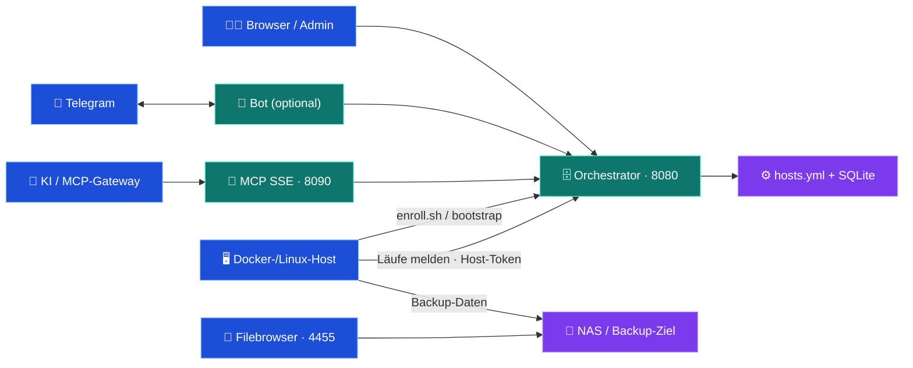

# 🗄️ hAI.BackupServer

[](https://www.buymeacoffee.com/highfish)

[](https://github.com/jbkunama1/hAI.BackupServer/actions/workflows/ghcr.yml)
[](docker-compose.yml)
[](app/main.py)
[](docs/TELEGRAM.md)
[](mcp_server/README.md)
[](LICENSE)
[](https://github.com/jbkunama1/hAI.BackupServer/stargazers)
[](https://github.com/jbkunama1/hAI.BackupServer/issues)

> Zentrales Backup-Control-Center für Docker- und Linux-Hosts: Web-Adminmenü, automatisch generierte Backup-Scripte, universelles Enroll-Script, Monitoring mit Historie, Telegram-Admin-Bot, REST-API und MCP.

`self-hosted` · `docker` · `backup` · `fastapi` · `bash` · `rsync` · `monitoring` · `telegram-bot` · `mcp` · `portainer` · `ghcr`

---

## ✨ Features

| Bereich | Funktion |
|---|---|
| 🖥️ Adminmenü | Dashboard, Monitoring-Historie, Host-Verwaltung, Einrichtungs-Anleitung, Einstellungen, Audit-Log |
| 🚀 Enrollment | `enroll.sh`: erkennt Container und Datenpfade, registriert den Host, richtet Script + Cron ein |
| 🧩 Bootstrap | Host manuell anlegen und individuelles Installationsscript laden – parallel zu Enroll nutzbar |
| 📦 Backup | Container-Images, mehrere Datenpfade je Container, PostgreSQL-Dumps, Crontab, /home-Verzeichnis, benutzerdefinierte Scripte |
| 🛡️ Schutz | Abbruch ohne NAS-Mount, Lock gegen Überlappung, Warnung statt falschem „OK“ |
| 📊 Monitoring | Läufe mit Historie, Zustände (OK, Warnung, Fehler, überfällig, unklar, pausiert) |
| 🤖 Telegram | Fehler sofort, Erfolge als Tagesdigest, Adminmenü mit Bestätigungen |
| 🔌 MCP / API | Sieben MCP-Tools und REST-API für Agenten |
| 📂 Filebrowser | Backup-Ziel im Browser durchsuchen |

Baut auf [hAI.FullBackupScript](https://github.com/jbkunama1/hAI.FullBackupScript) auf. Die Sicherung läuft **auf dem jeweiligen Host**, der Orchestrator verwaltet Konfiguration, Scripte und Reports.

## 🌐 Architektur



Drei getrennte Berechtigungen: **Admin** (Basic Auth), **Host** (eigenes Token, nur eigenes Script und eigene Reports) und **Enrollment** (Token, nur Registrierung). Clients erhalten nie das Admin-Passwort.

## 🚀 Quickstart (GHCR)

```bash
git clone https://github.com/jbkunama1/hAI.BackupServer.git
cd hAI.BackupServer
cp .env.example .env        # mindestens BASIC_AUTH_PASSWORD setzen
cp app/config/hosts.yml.example app/config/hosts.yml   # optional, wird sonst automatisch angelegt

docker network inspect highfishNetwork >/dev/null 2>&1 || docker network create highfishNetwork
docker compose --env-file .env pull
docker compose --env-file .env up -d
```

| Dienst | Adresse (Beispiel) |
|---|---|
| Web-UI / Adminmenü | `http://192.168.178.26:8080` |
| API-Dokumentation | `http://192.168.178.26:8080/docs` |
| MCP (SSE) | `http://192.168.178.26:8090/sse` |
| Filebrowser | `http://192.168.178.26:4455` |

Images: `ghcr.io/jbkunama1/hai.backupserver-{orchestrator,mcp,telegram}:latest` (AMD64 + ARM64). Der [Publish-Workflow](.github/workflows/ghcr.yml) veröffentlicht nur, wenn alle Tests bestehen. Private GHCR-Pakete brauchen Registry-Zugang; für anonymes Pullen muss das Paket public sein.

## 🐳 Portainer

1. `highfishNetwork` auf dem Docker-Host sicherstellen.
2. Stacks → Add stack → Repository: `https://github.com/jbkunama1/hAI.BackupServer`, `refs/heads/main`, `docker-compose.yml`.
3. Umgebungsvariablen aus [`.env.example`](.env.example) eintragen (Pflicht: `BASIC_AUTH_PASSWORD`).
4. Deploy; bei Updates **Pull and redeploy** mit Image-Aktualisierung.

`./app/config` (enthält `hosts.yml` und `backupserver.db`) muss erhalten bleiben – Stack nicht löschen, ohne vorher zu sichern. Die Templates stammen aus dem Image; es gibt keinen Template-Bind-Mount mehr.

## 🖥️ Hosts anbinden

**Voraussetzung auf jedem Client:** Docker, rsync, curl, findmnt und das NAS **bereits gemountet** unter `/mnt/highfishNAS25/Sicherung` – kein Script richtet einen Mount ein. Prüfen: `findmnt -T /mnt/highfishNAS25/Sicherung` muss das NAS zeigen, nicht `/`.

**A) Enroll (empfohlen)** – `ENROLL_TOKEN` am Server setzen, dann auf dem Host:

```bash
curl -fsS http://192.168.178.26:8080/enroll.sh -o enroll.sh && less enroll.sh
sudo ./enroll.sh --dry-run     # zeigt nur, was erkannt wird
sudo ./enroll.sh               # fragt Token und Container ab
```

**B) Manuell** – Host im Adminmenü anlegen, dann auf dem Host:

```bash
curl -fsS -u admin http://192.168.178.26:8080/bootstrap/HOST_ID -o bootstrap.sh
less bootstrap.sh && sudo bash bootstrap.sh --run-now
```

Beide legen `/etc/cron.d/hai-backup-<ID>` an (idempotent) und nutzen ein Host-Token. Details: [Enrollment](docs/ENROLLMENT.md) · [Rollout](docs/ROLLOUT.md).

## 📊 Monitoring

Jeder Lauf meldet Start und Ergebnis per HTTP (nicht über das NAS). Zustellprobleme werden lokal gespoolt und nachgereicht; Doppelmeldungen sind unschädlich.

| Zustand | Bedeutung |
|---|---|
| ✅ OK · ⚠️ Warnung · 🔴 Fehler | Ergebnis des letzten Laufs (fehlender Container = Warnung, nie „OK“) |
| ⏳ Läuft · ❓ Unklar | Aktiv bzw. gestartet, aber nie abgeschlossen |
| 🕑 Überfällig | Letzter Lauf älter als Intervall + Karenz |
| ❔ Keine Meldung | Neuer Host in der Einrichtungsfrist – nicht „nie gelaufen“ |
| ⏸️ Pausiert | Wartungsmodus |

Details und Grenzen: [Monitoring](docs/MONITORING.md).

## 🤖 Telegram-Bot (optional)

`TELEGRAM_BOT_TOKEN` (von @BotFather) und `TELEGRAM_ALLOWED_USER_IDS` setzen, `COMPOSE_PROFILES=telegram` aktivieren, dem Bot im Privatchat `/admin` senden. Default-Deny für Befehle und Buttons; mutierende Aktionen mit Bestätigung und Audit-Log. **Fehler sofort, Erfolge gebündelt als Tagesdigest** (08:00 Europe/Berlin) inklusive Hosts ohne Meldung. Token niemals in Chats oder Commits teilen. Siehe [Telegram](docs/TELEGRAM.md).

## 🔧 Konfiguration

| Variable | Default | Zweck |
|---|---|---|
| `BASIC_AUTH_USER` / `BASIC_AUTH_PASSWORD` | `admin` / **Pflicht** | Admin-Zugang (Web-UI, API) |
| `ORCHESTRATOR_HOST` | `192.168.178.26` | Adresse in generierten Scripten |
| `CRON_SCHEDULE` | `0 3 * * *` | Zeitplan auf den Clients |
| `ENROLL_TOKEN` | leer = aus | Token für `enroll.sh` |
| `TELEGRAM_BOT_TOKEN` / `TELEGRAM_ALLOWED_USER_IDS` | leer = Bot inaktiv | Bot-Zugang |
| `DIGEST_TIME` / `DIGEST_TZ` | `08:00` / `Europe/Berlin` | Tagesdigest |
| `DB_PATH`, `CONFIG_DIR`, `GENERATED_DIR` | unter `/app/config` bzw. `/app/generated` | Speicherorte |

Monitoring-Schwellen (Intervall, Karenz, Einrichtungsfrist, NAS-Dateisystemtypen) stellst du im Adminmenü unter **Einstellungen** ein.

## 🛡️ Sicherheit & Grenzen

- HTTP Basic Auth und Tokens laufen unverschlüsselt über HTTP: im LAN vertretbar, extern HTTPS/VPN vorschalten, Ports nicht ins Internet öffnen.
- `hosts.yml` enthält die Host-Tokens im Klartext – nur für Administratoren lesbar halten und mit sichern.
- Backup-Scripte auf den Clients enthalten ein Host-Token (Modus 700, nur root).
- Alle Eingaben werden validiert, Script-Werte per `shlex.quote` gequotet, Formulare sind CSRF-geschützt.
- „OK“ heißt: Alle konfigurierten Schritte liefen fehlerfrei. Es beweist nicht, dass die Konfiguration vollständig ist oder dass ein Restore funktioniert – **Restore-Tests bleiben Pflicht**.
- Dateikopien laufender Anwendungen sind nicht automatisch konsistent; für Datenbanken `db_containers` nutzen.
- Kein „Backup jetzt starten“ aus Web oder Bot: Das würde Fernausführung auf Clients erfordern.

## 🧪 Tests

```bash
pip install -r requirements.txt -r telegram_bot/requirements.txt pytest httpx
python -m pytest -q
```

Geprüft werden Validierung, SQLite-Speicher (parallele Schreibzugriffe, Migration), Zustandslogik, Enrollment, die generierten Bash-Scripte mit gemocktem Docker/NAS/curl/rsync, der Bot und die Templates. Die HTTP-API-Tests laufen in der CI. Ein End-to-End-Test auf deinen echten Hosts ersetzt das nicht.

## 🗺️ Roadmap

| Status | Baustein |
|---|---|
| ✅ | Adminmenü, Enroll + Bootstrap, SQLite-Monitoring, Telegram-Bot, MCP, GHCR mit Test-Gate |
| 🟡 offen | Fernauslösung eines Backups (bräuchte einen sicheren Client-Agenten) |
| 🟡 offen | Mehrere Datenpfade je Container bequemer im Formular, Restore-Assistent |
| 🟡 offen | Eigene MCP-Tools für Reports und Pause |

## 📚 Dokumentation

[Architektur](docs/ARCHITECTURE.md) · [Rollout](docs/ROLLOUT.md) · [Enrollment](docs/ENROLLMENT.md) · [Monitoring](docs/MONITORING.md) · [Telegram](docs/TELEGRAM.md) · [MCP-Integration](docs/mcp_integration.md) · [Restore-Anleitung](https://github.com/jbkunama1/hAI.FullBackupScript/blob/main/docs/RESTORE.md)

## 📄 Lizenz

MIT – siehe [LICENSE](LICENSE). Keine Gewährleistung für Datensicherheit. Ein Backup ist erst durch einen erfolgreichen Restore-Test praktisch überprüft.
